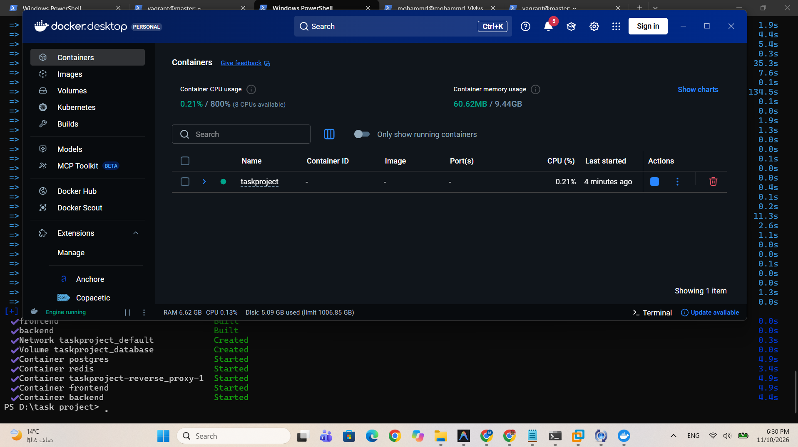
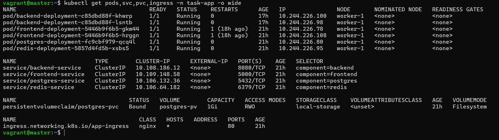
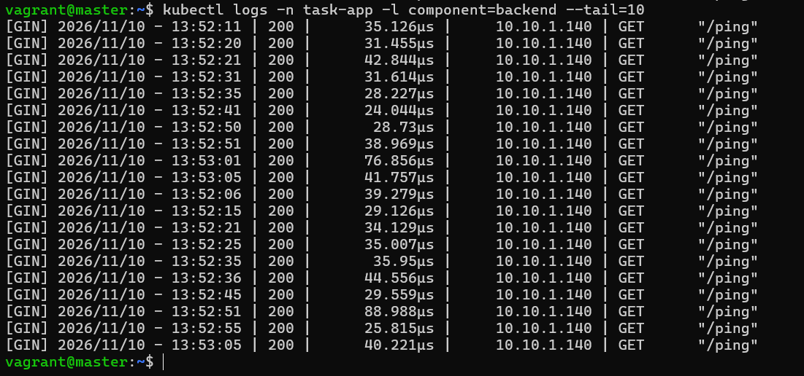
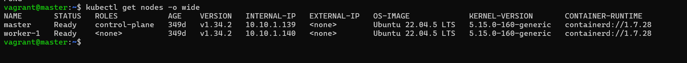
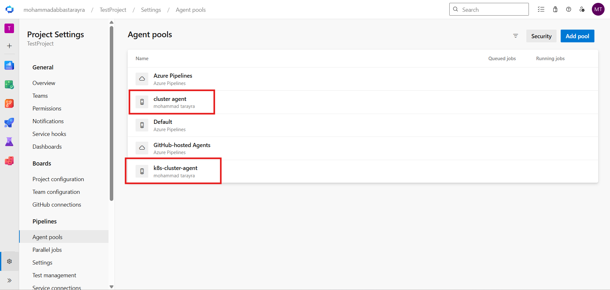
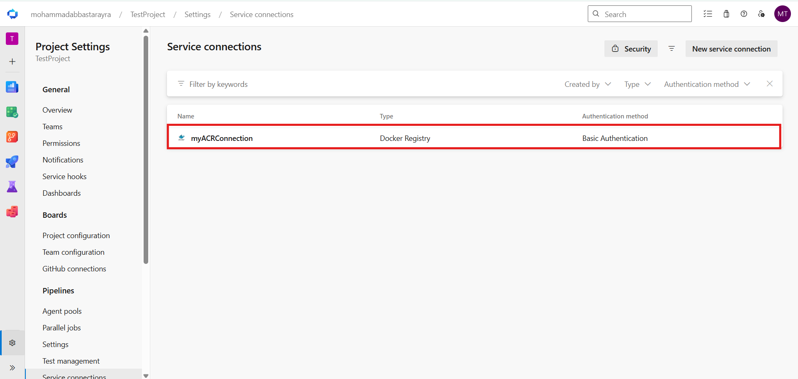
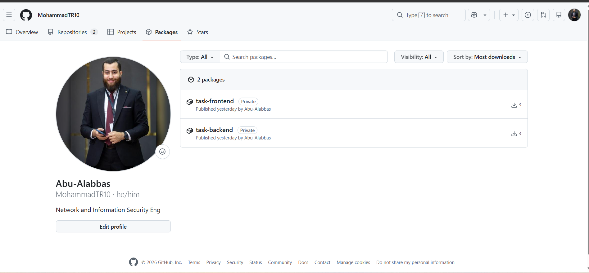
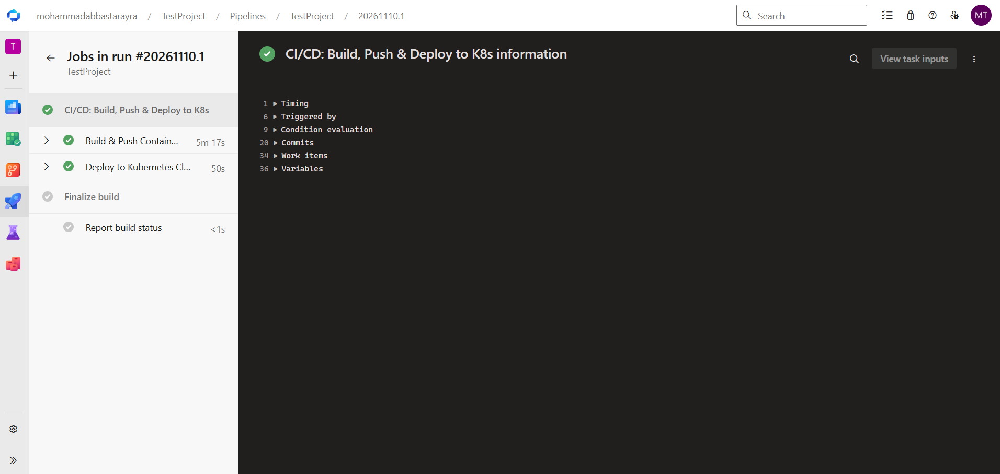
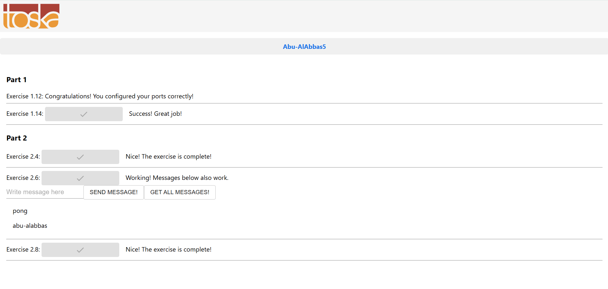

# Fullstack Microservices on Kubernetes with Azure DevOps CI/CD

An end-to-end DevOps project taking a multi-service web application from a local Docker Compose setup to a self-hosted Kubernetes cluster, automated with an Azure DevOps CI/CD pipeline using self-hosted agents and GitHub Container Registry (GHCR).

---

## 📖 Overview & Purpose

The goal of this project was to build complete, real-world DevOps infrastructure around an existing fullstack microservices application. 

### What was pre-existing:
* **The application code**: The React frontend and Go (Gin) backend were sourced from an open-source educational project.
* **Basic Dockerfiles**: The repository initially included starter Dockerfiles for the frontend and backend.

### What I built from scratch:
1. **Container Security Hardening**: Modified the Dockerfiles to create and run under a dedicated, unprivileged non-root user (`appuser`).
2. **Local Orchestration**: Created `docker-compose.yml` and configured an `nginx.conf` reverse proxy to run and test the complete stack locally with a single command.
3. **Kubernetes Architecture (`k8s/`)**: Authored all Kubernetes manifests from scratch, including namespaces, configuration decoupling (ConfigMaps & Secrets), persistent volume provisioning with node pinning, native health checks (liveness/readiness probes), resource boundaries, and ingress routing.
4. **Infrastructure as Code (Vagrant & Ansible)**: Built a local multi-node Kubernetes cluster (Master + Worker) running Ubuntu 22.04, containerd, and Calico CNI. (Hosted in a dedicated repo: [k8s-cluster-vagrant-ansible](https://github.com/MohammadTR10/k8s-cluster-vagrant-ansible)).
5. **Azure DevOps CI/CD Pipeline (`azure-pipelines.yml`)**: Designed and implemented an automated pipeline using self-hosted agents on the VMs, Docker Buildx with remote registry caching, immutable Build ID tagging, ordered manifest rollout, and zero-downtime deployment verification.

---

## 📁 Repository Structure

```text
├── .git/
├── app-screeshots/            # Screenshots documenting the working project
│   ├── complete-project.png
│   ├── docker-compose-local.png
│   ├── k8s-nodes-status.png
│   ├── k8s-pods-status.png
│   ├── health-probes-verification.png
│   ├── azure-agent-pools.png
│   ├── azure-service-connection.png
│   ├── ghcr-packages.png
│   └── pipeline-success.png
├── backend/                   # Go (Gin) REST API source code
│   └── Dockerfile             # Multi-stage scratch build + non-root user
├── frontend/                  # React Single Page Application source code
│   └── Dockerfile             # Multi-stage alpine build + non-root user
├── k8s/                       # Kubernetes manifests (built from scratch)
│   ├── namespace.yaml         # Isolated task-app namespace
│   ├── configmap.yaml         # Non-sensitive service endpoints & config
│   ├── secret.yaml            # Database credentials secret
│   ├── postgres-pv.yaml       # PersistentVolume with nodeAffinity
│   ├── postgres-pvc.yaml      # PersistentVolumeClaim for database
│   ├── data-services.yaml     # Postgres & Redis Deployments + Services
│   ├── backend.yaml           # Go API Deployment (2 replicas) + Service
│   ├── frontend.yaml          # React Deployment (2 replicas) + Service
│   └── ingress.yaml           # Ingress-NGINX path routing and rewrites
├── azure-pipelines.yml        # Azure DevOps CI/CD pipeline definition
├── docker-compose.yml         # Local multi-container development environment
├── nginx.conf                 # Nginx reverse proxy configuration for Docker Compose
└── README.md                  # Project documentation & reproduction guide
```

---

## 🧩 The Application Stack & Container Hardening

The application is composed of four interconnected services:
* **Frontend**: React SPA running on Node.js, providing an interactive dashboard with test buttons for each component.
* **Backend**: REST API written in Go using the Gin framework, handling business logic and querying the data layer.
* **Database (PostgreSQL 13)**: Persistent relational store for saving and retrieving messages.
* **Cache (Redis 7)**: In-memory key-value cache used for ping/pong connectivity checks.

```text
                     [ Client / Browser ]
                              │
                              ▼ Port 80 / 8080
                   [ Ingress / Reverse Proxy ]
                              │
             ┌────────────────┴────────────────┐
             │ Path: /                         │ Path: /api/*
             ▼                                 ▼
    [ React Frontend ]                 [ Go Gin Backend ]
        Port: 5000                         Port: 8080
                                               │
                                 ┌─────────────┴─────────────┐
                                 ▼                           ▼
                        [ PostgreSQL DB ]              [ Redis Cache ]
                           Port: 5432                     Port: 6379
```

### Non-Root Security Hardening

The original Dockerfiles ran container processes as `root`. Running as root inside a container poses a significant security vulnerability if a container breakout occurs. I updated both Dockerfiles to use an unprivileged user (`appuser`):

1. **Backend (`backend/Dockerfile`)**:
   * Uses a multi-stage build (`golang:1.16` build stage).
   * Creates `appuser` during the build step and sets file ownership on the compiled binary.
   * Copies only the static binary and `/etc/passwd` into a bare `scratch` image.
   * Drops root privileges using `USER appuser`.
   * **Result**: An extremely lightweight (~8.6 MB), attack-surface-minimized container image with no root access.

2. **Frontend (`frontend/Dockerfile`)**:
   * Multi-stage build (`node:14` build stage to compile static assets).
   * Runtime stage uses lightweight `node:14-alpine3.13` with `serve`.
   * Creates `appuser` using `adduser -D appuser`, assigns folder ownership to `build/`, and switches execution to `USER appuser`.

---

## 💻 Local Development: Docker Compose & Nginx

To run and verify the entire stack on a development machine without needing Kubernetes, I created `docker-compose.yml` and `nginx.conf` from scratch.

### Why Nginx as Reverse Proxy?
In a microservices setup, the frontend needs to reach the backend without running into Cross-Origin Resource Sharing (CORS) blocks or exposing internal container ports directly to the host. 

The `nginx.conf` acts as a single gateway on port 80:
* Requests to `/` proxy to `http://frontend_server:5000/`.
* Requests to `/api/` proxy to `http://backend_server:8080/`.

```nginx
events { worker_connections 1024; }

http {
    server {
        listen 80;

        location / {
            proxy_pass http://frontend_server:5000/;
        }

        location /api/ {
            proxy_set_header Host $host;
            proxy_pass http://backend_server:8080/;
        }
    }
}
```

### Running Locally:
```bash
docker-compose up -d --build
```
Once started, visiting `http://localhost` opens the application with all services connected.



---

## ☸️ Kubernetes Manifests (`k8s/`)

Transitioning from Docker Compose to Kubernetes required recreating the entire networking, storage, configuration, and compute lifecycle. All manifests were written from scratch inside the `k8s/` directory:

### 1. `k8s/namespace.yaml`
Isolates all application resources inside a dedicated namespace named `task-app`, keeping them separate from cluster system components (`kube-system`, `ingress-nginx`).

### 2. `k8s/configmap.yaml`
Centralizes non-sensitive environment variables so they can be managed outside of container images:
* `POSTGRES_HOST: postgres-service`
* `REDIS_HOST: redis-service`
* `POSTGRES_DB: postgres`
* `POSTGRES_USER: postgres`

### 3. `k8s/secret.yaml`
Stores the database password (`POSTGRES_PASSWORD`) as a Kubernetes Secret encoded in Base64. Containers consume this secret securely via `envFrom` rather than having hardcoded credentials in deployment specs.
*(Note: Test/default values are used here for demonstration).*

### 4. `k8s/postgres-pv.yaml` & `postgres-pvc.yaml`
Stateful storage for PostgreSQL:
* **The Challenge**: In a local multi-node VM cluster, `hostPath` storage is node-local (`/mnt/data/postgres`). If Kubernetes schedules the database pod onto a node that doesn't have that directory, the database will fail to start.
* **The Solution**: I configured `nodeAffinity` on the `PersistentVolume`, binding the volume strictly to `worker-1`:
  ```yaml
  nodeAffinity:
    required:
      nodeSelectorTerms:
      - matchExpressions:
        - key: kubernetes.io/hostname
          operator: In
          values:
          - worker-1
  ```
* The `postgres-pvc.yaml` claims 1Gi from this volume in the `task-app` namespace.

### 5. `k8s/data-services.yaml`
Defines Deployments and ClusterIP Services for both Redis and PostgreSQL:
* **Deployment Strategy**: Set to `strategy: type: Recreate` on PostgreSQL. Because `hostPath` is `ReadWriteOnce`, Kubernetes must terminate the old pod before launching a new one during updates to prevent disk lock conflicts.
* **Data Directory Configuration**: Added `PGDATA: /var/lib/postgresql/data/pgdata` to prevent PostgreSQL initialization failures caused by filesystem-level folders like `lost+found`.
* **Native Health Probes**:
  * PostgreSQL: Uses `pg_isready -U postgres` for both liveness and readiness probes.
  * Redis: Uses `redis-cli ping` for both liveness and readiness probes.
* **Resource Limits**: Configured explicit CPU and Memory requests and limits for both services to prevent node resource exhaustion.

### 6. `k8s/backend.yaml`
Deploys 2 replicas of the Go REST API:
* Pulls container images from GitHub Container Registry using `imagePullSecrets: acr-secret`.
* Injects environment variables dynamically from `app-config` (ConfigMap) and `app-secrets` (Secret).
* **Health Probes**: Configured HTTP GET probes targeting `/ping` on port 8080 (`livenessProbe` and `readinessProbe`).
* Resource constraints: Requests 100m CPU / 64Mi RAM, Limits 500m CPU / 256Mi RAM.
* Exposes a `ClusterIP` service on port 8080.

### 7. `k8s/frontend.yaml`
Deploys 2 replicas of the React user interface:
* HTTP GET probes on port 5000 (`/`) to verify static file serving.
* Resource constraints: Requests 50m CPU / 64Mi RAM, Limits 200m CPU / 128Mi RAM.
* Exposes a `ClusterIP` service on port 5000.

### 8. `k8s/ingress.yaml`
Configures Ingress-NGINX to route external HTTP traffic to internal services:
* Uses regex URL rewriting:
  * Path `/(.*)` routes to `frontend-service:5000`.
  * Path `/api/?(.*)` rewrites to `/$1` and routes to `backend-service:8080`.
* `pathType` set to `ImplementationSpecific` to support regex capture groups.




---

## 🖥️ Local Cluster Infrastructure (Vagrant & Ansible)

The Kubernetes cluster runs locally on two Ubuntu 22.04 virtual machines orchestrated with Vagrant (VMware Desktop provider) and provisioned automatically with Ansible:

* **Master Node (`master`)**: Control plane node (API Server, Controller Manager, Scheduler, etcd).
* **Worker Node (`worker-1`)**: Workload node where application pods and storage run.
* **Container Runtime**: `containerd`.
* **Cluster Networking (CNI)**: Calico.
* **Ingress Controller**: Ingress-NGINX.

> 🔗 **Dedicated Infrastructure Repository**:  
> For the complete `Vagrantfile`, Ansible playbooks, and step-by-step instructions to spin up this exact 2-node cluster from scratch, please visit:  
> **[k8s-cluster-vagrant-ansible](https://github.com/MohammadTR10/k8s-cluster-vagrant-ansible)**



---

## ⚙️ Azure DevOps & GitHub Integration (Setup Guide)

To automate deployments to a local, private VM cluster, I set up a hybrid CI/CD environment connecting Azure DevOps, GitHub, and the local virtual machines. This setup allows the pipeline to build, push, and deploy automatically with zero manual cluster interaction.

### 1. Self-Hosted Agent Pools
**Why Self-Hosted Agents?**  
Cloud-hosted build agents (such as standard Azure-hosted agents) cannot directly communicate with private local virtual machines without complex, expensive VPN tunnels. Configuring self-hosted agents running directly on the VMs allows Azure DevOps to dispatch jobs securely into the local environment.

**How the Agents Were Configured:**
1. In Azure DevOps, go to **Project Settings** → **Agent pools** (or Organization Settings → Agent pools).
2. Create two separate agent pools:
   * **`cluster agent`**: Assigned to the build host (`worker-1` or VM with Docker + Docker Buildx installed).
   * **`k8s-cluster-agent`**: Assigned to the Kubernetes master node (`master`), which has `kubectl` configured with cluster-admin rights.
3. In Azure DevOps, generate a **Personal Access Token (PAT)** under User Settings with the scope **Agent Pools (Read & manage)**.
4. On each VM:
   ```bash
   # Download and extract the Azure DevOps Linux agent
   mkdir myagent && cd myagent
   wget https://vstsagentpackage.azureedge.net/agent/3.x.x/vsts-agent-linux-x64-3.x.x.tar.gz
   tar zxvf vsts-agent-linux-x64-3.x.x.tar.gz

   # Configure the agent
   ./config.sh --unattended \
     --url https://dev.azure.com/mohammadabbastarayra \
     --auth pat \
     --token <YOUR_AZURE_DEVOPS_PAT> \
     --pool "cluster agent" \ # or "k8s-cluster-agent" on master
     --agent $(hostname)-agent \
     --acceptTeeEula

   # Install and start as a systemd background service
   sudo ./svc.sh install
   sudo ./svc.sh start
   ```
5. In Azure DevOps, verify that both agents show **Online** with a green status indicator.



### 2. GitHub Container Registry (GHCR) & Service Connection
To store and pull container images without depending on an active Azure cloud subscription, I used GitHub Container Registry (`ghcr.io`):

**How the Service Connection Was Configured:**
1. In GitHub, go to **Settings** → **Developer settings** → **Personal access tokens (classic)** and generate a PAT with `read:packages`, `write:packages`, and `delete:packages` scopes.
2. In Azure DevOps, open your project and navigate to **Project Settings** → **Service connections**.
3. Click **New service connection** → select **Docker Registry** → click **Next**.
4. Configure the connection parameters:
   * **Registry type**: Select **Others** (this allows connecting to any Docker-compliant registry like GHCR without needing an Azure subscription).
   * **Docker Registry**: `https://ghcr.io`
   * **Docker ID**: Your GitHub username (e.g. `MohammadTR10`)
   * **Docker Password**: The GitHub PAT generated in step 1.
   * **Service connection name**: `myACRConnection`
   * **Security**: Check the box **Grant access permission to all pipelines**.
5. Click **Save**. The pipeline uses this connection name via the `Docker@2` task to authenticate and push images without exposing credentials in the YAML file.




### 3. Pushing Code to Azure Repos & Running the Pipeline
Once the repository code is ready, the deployment is triggered by pushing to the Azure DevOps Git repository:

1. **Add the Azure Repos remote to your local git**:
   ```bash
   git remote add azure https://dev.azure.com/mohammadabbastarayra/TestProject/_git/TestProject
   # Or verify your remote:
   git remote -v
   ```
2. **Commit and push your changes**:
   ```bash
   git add .
   git commit -m "feat: complete devops pipeline and k8s infrastructure"
   git push azure master
   ```
3. **Trigger the Pipeline in Azure DevOps**:
   * In Azure DevOps, navigate to **Pipelines** → **Pipelines**.
   * (If creating for the first time: click **New Pipeline** → choose **Azure Repos Git** → select **TestProject** → choose **Existing Azure Pipelines YAML file** → select `/azure-pipelines.yml` → click **Continue**).
   * Click **Run pipeline**.
4. **Hands-Free Automated Deployment**:
   * `Job 1 (BuildPush)` automatically checks out the code on `cluster agent`, builds the images with Buildx caching, tags them with the immutable `$(Build.BuildId)`, and pushes to GHCR.
   * `Job 2 (ApplyK8s)` automatically runs on `k8s-cluster-agent`, applies the manifests in exact order, updates the deployments to the new image tag, and verifies the rollout status until every pod is healthy.
   * **You do NOT need to run any manual `kubectl` commands — the pipeline delivers a fully operational application automatically!**

---

## 🚀 The CI/CD Pipeline (`azure-pipelines.yml`)

### 💡 The Core Value: The "Git Push to Live" Developer Experience

The primary objective of this CI/CD pipeline is to eliminate operational friction and human error. In a traditional workflow, deploying changes often involves manual image building, SSHing into servers, updating YAML files, and manually restarting containers.

**With this pipeline in place, the developer experience is frictionless:**
1. A developer writes code (e.g., adds a new REST endpoint in Go or updates a UI button in React).
2. The developer commits and runs a single command:
   ```bash
   git push azure master
   ```
3. **The pipeline takes over end-to-end**:
   * Automatically packages the new code into hardened container images.
   * Pushes the images with an immutable, traceable Build ID (`$(Build.BuildId)`) to GitHub Container Registry.
   * Instructs the Kubernetes cluster to perform a zero-downtime rolling update.
   * Verifies that the new pods pass readiness probes before shifting live user traffic.
4. The developer does **not** need to touch `kubectl`, manage container runtimes, or configure servers. The change goes live automatically and safely.

> 📌 **Trigger Configuration Note**:  
> In `azure-pipelines.yml`, `trigger: none` is currently configured so that pipeline executions can be initiated intentionally during development and testing. In a day-to-day team setting, switching to `trigger: - master` enables fully hands-free continuous deployment upon every single `git push`.

---

### Deployment Flow Diagram

The deployment workflow is split into two sequential jobs:

```text
 [ Git Push to Azure Repos ]
            │
            ▼
┌────────────────────────────────────────┐
│  Job 1: BuildPush                      │
│  Pool: 'cluster agent'                 │
│  - Login to GHCR via Service Connection│
│  - Setup Docker Buildx                 │
│  - Build & Push Frontend (cached)      │
│  - Build & Push Backend (cached)       │
│  - Tag with $(Build.BuildId) + latest  │
└───────────────────┬────────────────────┘
                    │ (DependsOn: BuildPush)
                    ▼
┌────────────────────────────────────────┐
│  Job 2: ApplyK8s                       │
│  Pool: 'k8s-cluster-agent'             │
│  - Verify/Ensure acr-secret            │
│  - Apply Namespace, Configs, Storage   │
│  - Apply Services & Ingress            │
│  - Apply Deployments                   │
│  - Update image tag to $(Build.BuildId)│
│  - Verify Rollout (timeout 300s)       │
└────────────────────────────────────────┘
```

### Detailed Pipeline Breakdown:

1. **Job 1: `BuildPush`** (Runs on `cluster agent`):
   * **Task**: `Docker@2` logs in securely using `$(dockerRegistryServiceConnection)`.
   * **Buildx Setup**: Initializes a `buildx` builder instance.
   * **Caching**: Uses `--cache-from` and `--cache-to` pointing to remote registry cache tags (`task-frontend:cache` and `task-backend:cache`). This significantly reduces build times on repeated runs.
   * **Immutable Tagging**: Images are tagged with the specific Azure DevOps build ID (`$(Build.BuildId)`) as well as `latest`.

2. **Job 2: `ApplyK8s`** (Runs on `k8s-cluster-agent`, depends on `BuildPush`):
   * **Prerequisites**: Ensures `acr-secret` is present in the `task-app` namespace.
   * **Ordered Manifest Deployment**: Applies manifests in logical dependency order:
     1. Namespace (`namespace.yaml`)
     2. Secret (`secret.yaml`) & ConfigMap (`configmap.yaml`)
     3. PersistentVolume (`postgres-pv.yaml`) & PersistentVolumeClaim (`postgres-pvc.yaml`)
     4. Data services (`data-services.yaml` for Postgres & Redis)
     5. Ingress (`ingress.yaml`)
     6. Application Deployments (`frontend.yaml` & `backend.yaml`)
   * **Image Update**: Executes `kubectl set image` to point the deployments to the exact new immutable tag:
     ```bash
     kubectl set image deployment/backend-deployment backend=$(registry)/$(imageName)-backend:$(Build.BuildId) -n task-app
     kubectl set image deployment/frontend-deployment frontend=$(registry)/$(imageName)-frontend:$(Build.BuildId) -n task-app
     ```
   * **Rollout Verification**: Runs `kubectl rollout status --timeout=300s` on both deployments. The pipeline will only succeed if the new pods pass readiness probes and traffic successfully switches over.



---

## 🛠️ Reproduction & Deployment Guide

You can run and test this project using any of the following three methods:

### Option 1: The Automated CI/CD Way (Primary & Recommended)
This is the primary way the project is intended to be deployed. The pipeline handles all building, pushing, manifest applying, and rollout verification automatically.

1. **Spin up the cluster**: Provision the 2-node cluster using the [k8s-cluster-vagrant-ansible](https://github.com/MohammadTR10/k8s-cluster-vagrant-ansible) repository.
2. **Ensure storage path exists on worker-1**:
   ```bash
   vagrant ssh worker-1
   sudo mkdir -p /mnt/data/postgres && sudo chmod 777 /mnt/data/postgres
   exit
   ```
3. **Configure Azure DevOps Agents & Service Connection**: Follow the setup steps in the [Azure DevOps Setup Guide](#-azure-devops--github-integration-setup-guide) above.
4. **Push code and trigger pipeline**:
   ```bash
   git push azure master
   ```
5. Open Azure Pipelines and click **Run pipeline**. Once both jobs complete green, your entire application is deployed and live!
6. **Access the app**:
   ```bash
   # From the master node, port-forward the Ingress controller:
   kubectl port-forward -n ingress-nginx svc/ingress-nginx-controller 8080:80 --address 0.0.0.0
   ```
   Open `http://<MASTER_VM_IP>:8080` in your browser.

---

### Option 2: Quick Local Run with Docker Compose
If you do not want to set up Kubernetes or Azure DevOps and just want to test the multi-service application locally:

```bash
# 1. Clone the repository
git clone https://dev.azure.com/mohammadabbastarayra/TestProject/_git/TestProject
cd TestProject

# 2. Start all services locally
docker-compose up -d --build

# 3. Check container status
docker-compose ps

# 4. Open in browser
# http://localhost
```

---

### Option 3: Manual Kubernetes Deployment (Fallback without CI/CD)

> ℹ️ **Note**: This manual method is strictly a **fallback** for developers who want to inspect or test the Kubernetes YAML manifests directly without setting up Azure DevOps.  
> **If you used Option 1 (CI/CD Pipeline), all of the following steps were already performed for you automatically!**

```bash
# 1. Log into your Kubernetes master node
vagrant ssh master
cd /path/to/project

# 2. Create the namespace
kubectl apply -f k8s/namespace.yaml

# 3. Apply configurations & credentials
kubectl apply -f k8s/secret.yaml
kubectl apply -f k8s/configmap.yaml

# 4. Create image pull secret for GHCR
kubectl create secret docker-registry acr-secret \
  --docker-server=ghcr.io \
  --docker-username=<YOUR_GITHUB_USERNAME> \
  --docker-password=<YOUR_GITHUB_PAT> \
  --namespace=task-app

# 5. Provision persistent storage
kubectl apply -f k8s/postgres-pv.yaml
kubectl apply -f k8s/postgres-pvc.yaml

# 6. Deploy database, cache, and ingress routing
kubectl apply -f k8s/data-services.yaml
kubectl apply -f k8s/ingress.yaml

# 7. Deploy frontend and backend microservices
kubectl apply -f k8s/backend.yaml
kubectl apply -f k8s/frontend.yaml

# 8. Check rollout and pod health
kubectl get pods -n task-app -w

# 9. Access the application via port-forward
kubectl port-forward -n ingress-nginx svc/ingress-nginx-controller 8080:80 --address 0.0.0.0
```

---

## ✅ Application Verification & Test Results

The application interface includes built-in verification tests for each tier. When opened through Ingress, clicking each test button verifies end-to-end functionality:

* **Exercise 1.12 (Port Configuration)**: Confirms ports are mapped and the frontend is reachable.
* **Exercise 1.14 (Frontend-to-Backend API)**: Confirms the frontend can query the Go backend API over `/api/ping`.
* **Exercise 2.4 (Redis Cache Connection)**: Backend successfully pings Redis and receives a pong response.
* **Exercise 2.6 (PostgreSQL Database Connection)**: Backend connects to PostgreSQL, writes a new message to the database, and reads back the message history.
* **Exercise 2.8 (Ingress Routing)**: Verifies that Ingress-NGINX correctly routes both the static frontend assets and the backend API through a unified domain/port without CORS errors.



---

## 📷 Screenshots Guide

The following table lists the screenshots used throughout this documentation and what each image captures:

| Screenshot File | Location in Repo | What to Capture |
|---|---|---|
| `complete-project.png` | `app-screeshots/complete-project.png` | Web browser showing the app running at `http://10.10.1.139:8080` with all exercises passing (1.12, 1.14, 2.4, 2.6, 2.8) and a test message submitted. |
| `docker-compose-local.png` | `app-screeshots/docker-compose-local.png` | Terminal output of `docker-compose up -d` followed by `docker compose ps` showing the 5 containers running locally. |
| `k8s-nodes-status.png` | `app-screeshots/k8s-nodes-status.png` | Terminal output of `kubectl get nodes -o wide` showing `master` and `worker-1` both in `Ready` status. |
| `k8s-pods-status.png` | `app-screeshots/k8s-pods-status.png` | Terminal output of `kubectl get pods,svc,pvc,ingress -n task-app -o wide` showing all pods `1/1 Running`, PVC `Bound`, and Ingress active. |
| `health-probes-verification.png` | `app-screeshots/health-probes-verification.png` | Terminal output of backend pod logs (`kubectl logs -n task-app -l component=backend`) showing successful `GET "/ping"` requests returning HTTP 200. |
| `azure-agent-pools.png` | `app-screeshots/azure-agent-pools.png` | Azure DevOps Project Settings → Agent Pools showing both `cluster agent` and `k8s-cluster-agent` pools with online agents. |
| `azure-service-connection.png` | `app-screeshots/azure-service-connection.png` | Azure DevOps Project Settings → Service Connections showing the `myACRConnection` Docker Registry connection to `ghcr.io`. |
| `ghcr-packages.png` | `app-screeshots/ghcr-packages.png` | GitHub Packages web interface showing `task-backend` and `task-frontend` container packages with tagged builds. |
| `pipeline-success.png` | `app-screeshots/pipeline-success.png` | Azure Pipelines run details page showing both stages/jobs (`BuildPush` and `ApplyK8s`) completed successfully in green. |

---

## ⚠️ Realistic Engineering Limitations

To maintain honesty regarding this setup:
1. **Local VM Environment**: The cluster runs on local virtual machines via Vagrant with limited CPU and RAM (2 vCPUs per VM), not on a managed cloud service like AKS or EKS.
2. **Single Database Instance & HostPath Storage**: PostgreSQL runs as a single replica bound to `worker-1` via `nodeAffinity` because it uses a local `hostPath` volume. In an enterprise cloud setup, this would be replaced with a CSI driver (e.g. Azure Managed Disks), distributed storage (Longhorn/Ceph), or a managed database service (Azure Database for PostgreSQL).
3. **Local Secret File**: `k8s/secret.yaml` contains default demonstration credentials (`postgres`) to make testing reproducible. In a production environment, secrets would be injected via Azure Key Vault, Sealed Secrets, or external secrets operators.
4. **Base Image Versions**: The application source code uses older versions of Go (1.16) and Node.js (14) as provided by the original educational project.

---

## 👤 Author

**Mohammad Tarayra**  
* DevOps & Cloud enthusiast focusing on Kubernetes, Docker, Azure DevOps, Ansible, and Linux.  
* GitHub: [@MohammadTR10](https://github.com/MohammadTR10)  
* Infrastructure Repo: [k8s-cluster-vagrant-ansible](https://github.com/MohammadTR10/k8s-cluster-vagrant-ansible)
